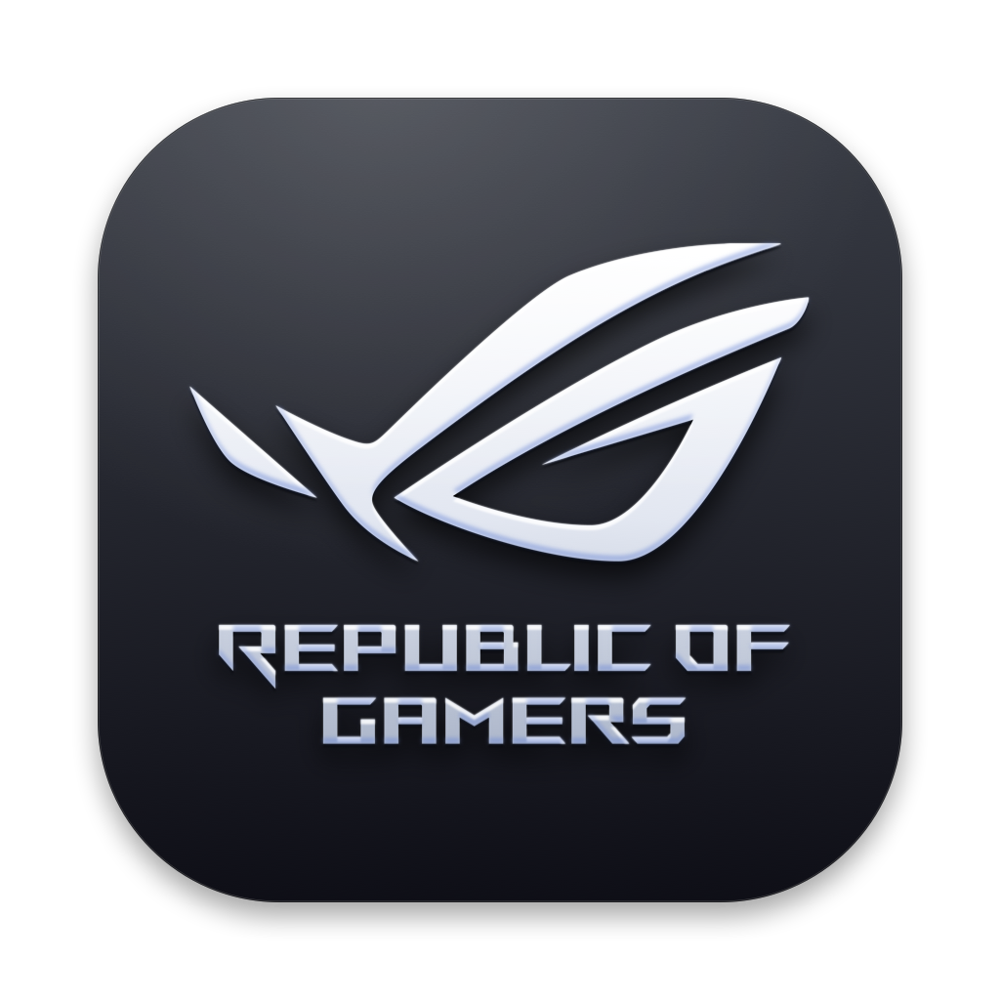
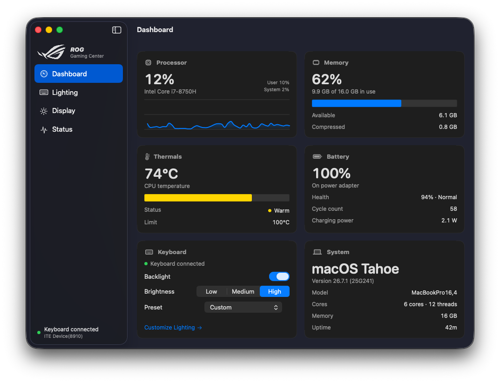

<p align="center">
  
</p>

<h1 align="center">ROG Gaming Center for macOS</h1>

<p align="center">
  Keyboard lighting, system vitals and display profiles for ASUS ROG laptops running macOS.<br/>
  A native SwiftUI app, built for Hackintosh.
</p>

<p align="center">
  
  
  <a href="https://github.com/sritulasiram/rog-gaming-center-hackintosh/releases/latest"></a>
  
</p>

<p align="center">
  
</p>

---

ASUS's own software (Armoury Crate) only runs on Windows. ROG Gaming Center covers the essentials on macOS:

- **Keyboard lighting.** Static, Breathing, Color Cycle, Rainbow and Strobe effects, per-zone colors, brightness, built-in and saved presets, and a live four-zone preview.
- **Dashboard.** CPU load with history, memory, CPU temperature, battery charge and health, and quick keyboard controls.
- **Display profiles.** Six GameVisual-style profiles applied to every connected display. Your normal calibration is restored when you quit.
- **Hotkeys.** The ROG key, Fn+↑/↓ for backlight brightness, and Fn+F11 for sleep, plus optional system-wide shortcuts.
- **Menu bar.** Backlight, brightness, lighting preset and display profile.
- **CLI.** `rogauracore` controls the backlight from Terminal or scripts.

It talks to the keyboard controller directly through IOKit. No kexts are required for lighting, and nothing runs as root. Readings come from the system; if a sensor isn't available, the app says so instead of estimating.

## Requirements

- macOS 14 Sonoma or later
- An ASUS laptop with the ITE "Aura" USB keyboard controller (vendor `0x0B05`). See [compatibility](docs/HACKINTOSH.md#compatible-laptops).
- Xcode or the Command Line Tools to build (`xcode-select --install`)

## Install

**Disk image:** download the `.dmg` from [Releases](https://github.com/sritulasiram/rog-gaming-center-hackintosh/releases), drag the app to Applications, and approve it once in System Settings → Privacy & Security. It isn't notarized; see [Installation](docs/INSTALLATION.md#install-from-a-disk-image).

**From source:**

```bash
git clone https://github.com/sritulasiram/rog-gaming-center-hackintosh.git
cd rog-gaming-center-hackintosh
./build.sh --install
```

This builds the app and the CLI, installs **ROG Gaming Center** to `/Applications` and launches it. On first launch, allow **Input Monitoring** when asked: macOS requires it for keyboard lighting and hotkeys.

Full steps, signing and uninstalling: **[Installation](docs/INSTALLATION.md)**.

## Documentation

| Guide | What's in it |
| :--- | :--- |
| [Installation](docs/INSTALLATION.md) | Building, permissions, code signing, updating, uninstalling |
| [User Guide](docs/USER_GUIDE.md) | Every screen, the menu bar, settings, hotkeys and shortcuts |
| [Hackintosh Notes](docs/HACKINTOSH.md) | Compatible laptops, USB mapping, sensors (temperature and fan) |
| [CLI Reference](docs/CLI.md) | `rogauracore` commands and scripting examples |
| [Troubleshooting](docs/TROUBLESHOOTING.md) | Lighting not responding, missing sensors, hotkeys, display issues |
| [Architecture](docs/ARCHITECTURE.md) | Code layout, the Aura protocol, design decisions, development and tests |

## Project Status

Stable (2.0.0). Developed and verified on an **ASUS ROG Strix GL503GE** (ITE 8910, `PID 0x1869`). Other ITE-based ROG and TUF models should work. If you try one, please [open an issue](https://github.com/sritulasiram/rog-gaming-center-hackintosh/issues) with your model and the output of `rogauracore --diagnose`.

## Acknowledgements

- [wroberts/rogauracore](https://github.com/wroberts/rogauracore): original reverse-engineering of the Aura USB protocol on Linux
- [black-dragon74/macRogAuraCore](https://github.com/black-dragon74/macRogAuraCore): early macOS IOKit implementation
- [hieplpvip/AsusSMC](https://github.com/hieplpvip/AsusSMC): ASUS hardware support for macOS
- [Acidanthera](https://github.com/acidanthera): OpenCore, Lilu and VirtualSMC
- [G-Helper](https://github.com/seerge/g-helper) and [asusctl](https://gitlab.com/asus-linux/asusctl): inspiration for lightweight ASUS tools

## Disclaimer

An independent community project, not affiliated with or endorsed by ASUSTeK Computer Inc. or Apple Inc. ASUS, ROG, Republic of Gamers, Aura, Armoury Crate, Apple and macOS are trademarks of their respective owners and are used only for identification. The software writes directly to your keyboard's USB controller and is provided as is, without warranty.

## License

[MIT](LICENSE) © 2026 Sri Tulasi Ram
