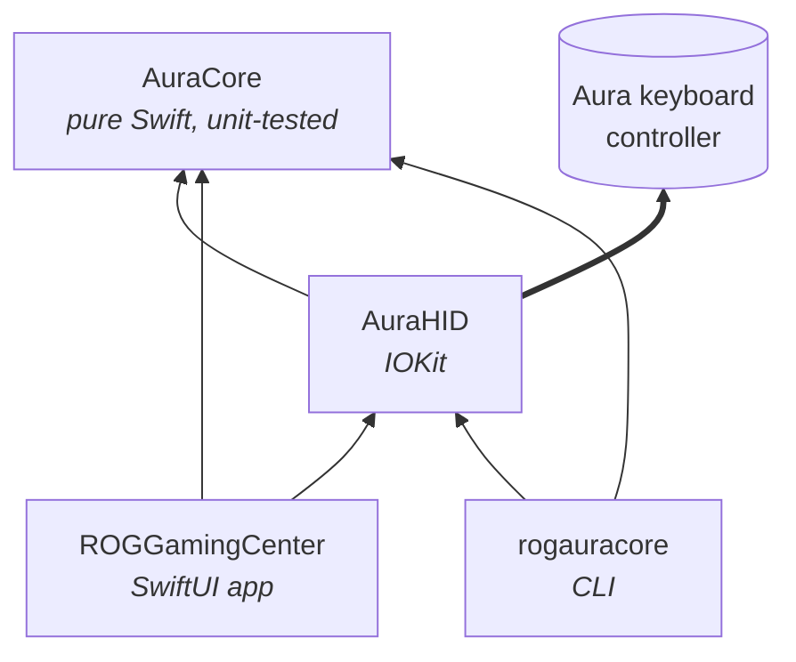
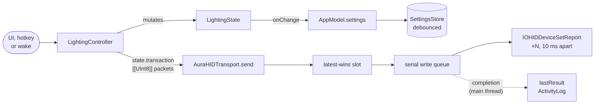
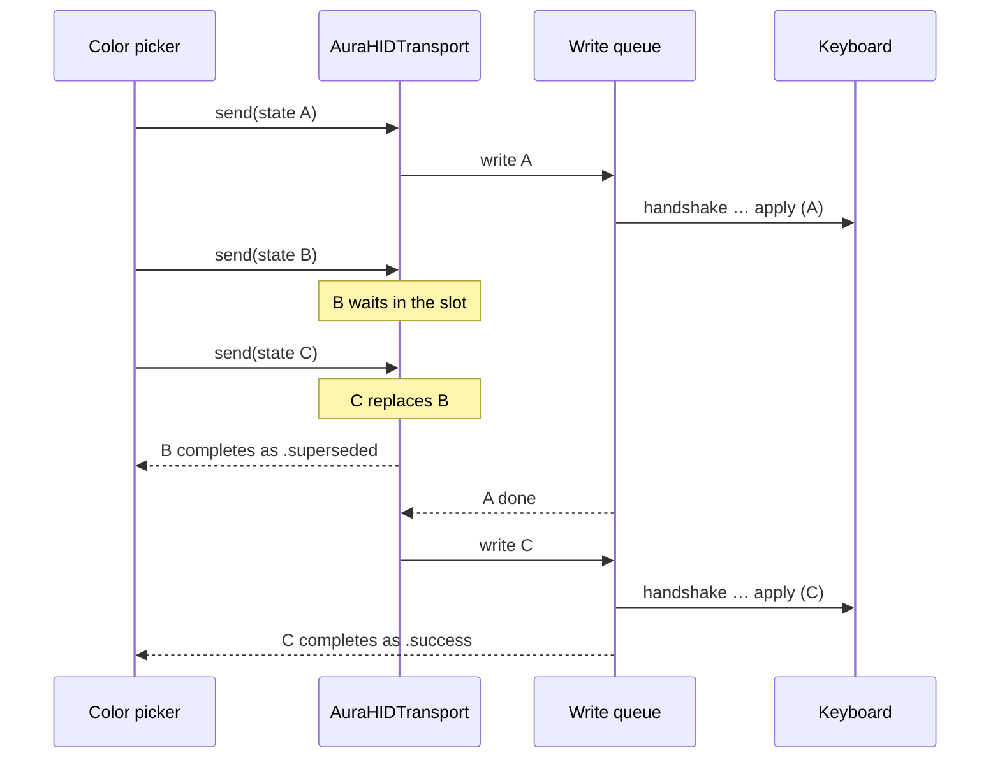
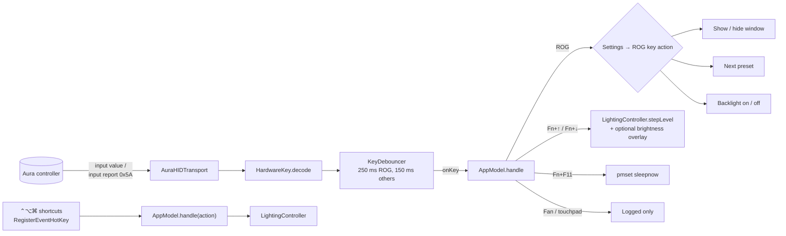

# Architecture

For contributors: how the code is organized, how it talks to the hardware, and why it's built this way.

- [Layout](#layout)
- [Modules](#modules)
- [Data flow](#data-flow)
- [The Aura protocol](#the-aura-protocol)
- [Hotkeys](#hotkeys)
- [Design decisions](#design-decisions)
- [Development](#development)

## Layout

```
Package.swift
Sources/
├── AuraCore/              Pure Swift. No AppKit or IOKit. Fully unit-tested.
│   ├── AuraProtocol.swift     Colors, modes, presets, 17-byte packet builder
│   ├── AuraEffects.swift      Effect families, mode editing, preview animation
│   ├── LightingState.swift    Complete backlight state → packet transaction
│   ├── HardwareKeys.swift     Hotkey decoding, debouncing, interface selection
│   └── DisplayProfile.swift   Display profiles and their gamma curves
├── AuraHID/
│   └── AuraHIDTransport.swift IOKit HID: discovery, access, writes, key input
├── ROGGamingCenter/       The app
│   ├── App/                   Entry point, scenes, menus, AppModel, settings
│   ├── Lighting/              LightingController
│   ├── System/                Telemetry, SMC, display, login item, shortcuts, log
│   └── Views/                 SwiftUI views
└── rogauracore/           The CLI
Tests/AuraCoreTests/       Unit tests for AuraCore
build.sh                   Builds, bundles, signs and installs
make-dmg.sh                Packages the app into a distributable disk image
```

## Modules

| Module | Depends on | Role |
| :--- | :--- | :--- |
| `AuraCore` | Foundation | Everything that can be computed without hardware: packet bytes, mode transformations, key decoding, which HID interface to use, gamma curves |
| `AuraHID` | AuraCore, IOKit | The only code that touches the keyboard controller |
| `ROGGamingCenter` | AuraCore, AuraHID, SwiftUI, Charts | App state, system services and UI |
| `rogauracore` | AuraCore, AuraHID | Command-line front end |



Arrows point from a module to what it depends on. Only `AuraHID` talks to the hardware.

### App state

`AppModel` (`@MainActor @Observable`) is the root object. It owns the controllers and routes events between them:

| Object | Responsibility |
| :--- | :--- |
| `LightingController` | Single owner of `LightingState` and custom presets; every change sends the full state |
| `TelemetryMonitor` | CPU, memory, battery, thermal and uptime readings; samples only while observed |
| `DisplayController` | Applies display profiles to all displays, reapplies on reconfiguration, restores on quit |
| `LoginItemController` | `SMAppService` login item |
| `GlobalShortcuts` | ⌃⌥⌘ hotkeys through `RegisterEventHotKey` |
| `ActivityLog` | In-memory event log shown in Status |
| `SettingsStore` | Persists `AppSettings` and migrates 1.x settings |

Views read state from the environment (`@Environment(AppModel.self)`) and call controller methods; they hold no hardware logic.

## Data flow



**Latest-wins.** Each write is a complete lighting state. The transport keeps one pending slot. If a new state arrives while one is being written, the pending one is replaced, and its completion reports `.superseded`. Dragging a color picker therefore sends at most one transaction behind the newest value, never a backlog:



**Cross-process lock.** Writes take a per-user `flock` (`$TMPDIR/rog-gaming-center.hid.lock`) so the app and CLI never interleave packets. The lock never blocks for more than about a second.

## The Aura protocol

All messages are 17-byte HID **feature reports**. Byte 0 is the report ID. The controller needs about 10 ms between reports.

| Packet | Bytes |
| :--- | :--- |
| Handshake | `5A` + ASCII `"ASUS Tech.Inc."`, zero-padded |
| Brightness | `5A BA C5 C4 LL`, where `LL` is 0–3 |
| Mode | `5D B3 ZZ MM RR GG BB SS 00 DD R2 G2 B2`. `ZZ` is the zone (0 = all, 1–4); `MM` the mode; `SS` the speed; `DD`, `R2`–`B2` the second color for breathing |
| Set | `5D B5` |
| Apply | `5D B4` |

| Mode | `MM` | Notes |
| :--- | :--- | :--- |
| Static | `00` | `SS` = `EB` |
| Breathing | `01` | `DD` = `01` enables the second color |
| Color cycle | `02` | `RR` = `FF` |
| Rainbow | `03` | Sent to zone 0 and zones 1–4 |
| Strobe | `0A` | |

Speeds: `E1` slow, `EB` normal, `F5` fast.

A full transaction is: handshake → brightness → mode packet(s) → set → apply. "Off" is a static mode with brightness 0. See `AuraPacketBuilder` and its tests.

### Interface selection

`AuraInterfaceSelector.select` picks which enumerated interfaces receive writes:

1. Vendor `0x0B05` with a max feature report of 16 bytes or more.
2. Prefer vendor usage pages (`≥ 0xFF00`), and among those known product IDs.
3. Fall back to known product IDs on any page.
4. Never mix product IDs.

This prevents writing lighting packets to other ASUS devices.

## Hotkeys

The transport registers both an input-value and an input-report callback on the ASUS interfaces. A single key press usually triggers both, and `KeyDebouncer` collapses them: 250 ms for the ROG key, 150 ms for the others.

| Code | Key |
| :--- | :--- |
| `0x38`, `0xF8` | ROG |
| `0xC4` / `0xC5` | Backlight up / down |
| `0x99`, `0xAE` | Fan |
| `0x6B` | Touchpad |
| `0x6C` | Sleep |

Values are accepted on usage pages `0xFF31`, `0xFF89` and `0xFF00`, and as byte 1 of report `0x5A`.

From key press to action:



The ⌃⌥⌘ shortcuts take a separate path through `GlobalShortcuts`, so they work on any keyboard.

## Design decisions

- **No synthetic data.** Every reading comes from the OS. Missing sensors are shown as unavailable, never estimated.
- **Hardware-only hotkeys.** Fn and F-keys aren't intercepted with `NSEvent` monitors. On macOS, arrow and F-keys always carry the "function" modifier, so such monitors fire system-wide on ordinary key presses. Only vendor HID reports from the controller are used, plus explicit `RegisterEventHotKey` shortcuts.
- **Gamma from ColorSync.** Each profile is computed from the display's current ColorSync table, obtained through `CGDisplayRestoreColorSyncSettings`. Gamma is only touched once a non-Standard profile has been used, so Night Shift and similar tools aren't disturbed.
- **On-demand telemetry.** Sampling runs only while a view that shows it is open, and stops when the last one closes.
- **One settings value.** `AppSettings` is stored as a single JSON value (`AppSettings.v1`) and decodes missing keys with defaults, so new settings need no migration.
- **System accent color.** The UI uses the user's accent color. ROG identity comes from the emblem and icon. Red appears only where it's an actual lighting color.
- **Not sandboxed.** Raw feature reports to a vendor HID device aren't reliably permitted in the sandbox.

## Development

### Build and run

```bash
swift build                        # debug build of everything
swift run ROGGamingCenter          # run the app unbundled (uses ./Resources for images)
swift run rogauracore --diagnose   # run the CLI
./build.sh                         # release .app bundle in ./build
./make-dmg.sh                      # disk image in ./build
```

The unbundled app has its own identity, so macOS asks for Input Monitoring for the binary (or your terminal) separately.

### Tests

```bash
swift test
```

With only the Command Line Tools installed (no Xcode), point SwiftPM at the bundled Testing framework:

```bash
F=/Library/Developer/CommandLineTools/Library/Developer/Frameworks
swift test -Xswiftc -F -Xswiftc $F -Xlinker -F -Xlinker $F -Xlinker -rpath -Xlinker $F \
  -Xlinker -rpath -Xlinker /Library/Developer/CommandLineTools/Library/Developer/usr/lib
```

Tests cover packet layout and framing, color parsing, mode editing and conversion, preview colors, lighting state, key decoding and debouncing, interface selection, and display curves. CI (`.github/workflows/ci.yml`) runs `swift build` and `swift test` on every push.

Hardware checks:

```bash
swift run rogauracore --diagnose   # which interface is selected, access state
swift run rogauracore --keys       # verify hotkey decoding on your model
```

### Adding a laptop

1. Run `rogauracore --diagnose` on the machine and note the product ID and usage page of the lighting interface.
2. Add the product ID to `AuraInterfaceSelector.knownProductIDs`.
3. If it uses a new hotkey code or usage page, extend `HardwareKey`. Add a test for any change in `AuraCore`.
