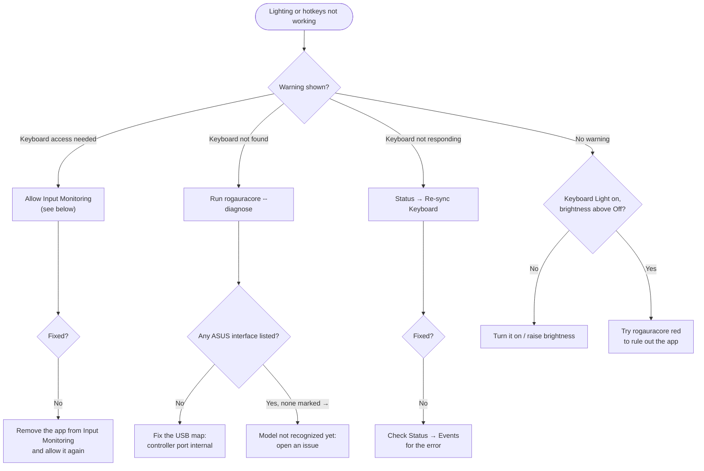

# Troubleshooting

Start with **Status** in the app. It shows the keyboard connection, permission state, sensors, and a log of recent events and errors. For more detail, run `rogauracore --diagnose`.

## Where to start

The menu bar panel and the bottom of the sidebar show one of three warnings when the keyboard isn't working. Follow the one you see:

Details for each step are in the sections below.

- [Where to start](#where-to-start)
- [Lighting doesn't change](#lighting-doesnt-change)
- ["Keyboard access needed" won't go away](#keyboard-access-needed-wont-go-away)
- ["Keyboard not found"](#keyboard-not-found)
- [Lighting is off or wrong after sleep](#lighting-is-off-or-wrong-after-sleep)
- [ROG key or Fn+↑/↓ does nothing](#rog-key-or-fn-does-nothing)
- [No brightness overlay](#no-brightness-overlay)
- [CPU temperature or fan speed missing](#cpu-temperature-or-fan-speed-missing)
- [Battery health missing](#battery-health-missing)
- [Display colors look wrong](#display-colors-look-wrong)
- [Shortcuts don't work](#shortcuts-dont-work)
- [Open at login doesn't stick](#open-at-login-doesnt-stick)
- [Reporting a bug](#reporting-a-bug)

## Lighting doesn't change

1. Look at the status at the bottom of the sidebar, or the warning at the top of the menu bar panel.
   - **Keyboard access needed:** see the next section.
   - **Keyboard not found:** see [Keyboard not found](#keyboard-not-found).
   - **Keyboard not responding:** the last write failed. Open **Status** for the error, then click **Re-sync Keyboard**.
2. Make sure the backlight is on (**Keyboard Light** in the menu bar, **Backlight** on the dashboard) and brightness isn't at its lowest in a dark room.
3. Try `rogauracore red` from Terminal. Your terminal needs Input Monitoring for this. If the CLI works but the app doesn't, it's a permission issue with the app.

## "Keyboard access needed" won't go away

macOS ties Input Monitoring to the app's code signature.

1. Open System Settings → Privacy & Security → Input Monitoring.
2. If **ROG Gaming Center** is listed, turn it off and on again. If it's listed but the app still asks, remove it with **−** and click **Allow Access** in the app again.
3. Switch back to the app. It detects the change without a restart.

If this happens after every rebuild, your build is signed ad hoc. See [Installation → Code signing](INSTALLATION.md#code-signing).

## "Keyboard not found"

- Run `rogauracore --diagnose`. If it lists no ASUS interfaces, macOS doesn't see the controller at all. Check your USB map: the controller's port must be included and marked internal. See [USB mapping](HACKINTOSH.md#usb-mapping).
- If it lists interfaces but none is marked `→`, your model's controller isn't recognized yet. Please open an issue with the output.

## Lighting is off or wrong after sleep

The controller loses its state when the laptop sleeps, and the app restores it about half a second after wake. If it doesn't:

- Make sure the app is running (menu bar icon) and that **Keep running in the menu bar** is on, if you usually close the window.
- Check **Status → Events** for "Restored after wake" and any error after it.
- If the controller vanishes after sleep ("Keyboard disconnected" with no reconnect), fix the USB port type. See [USB mapping](HACKINTOSH.md#usb-mapping).
- Press ⇧⌘R (Re-sync Keyboard) to resend manually.

## ROG key or Fn+↑/↓ does nothing

1. Input Monitoring must be allowed. Hotkeys are read from the controller just like lighting.
2. Check Settings → Keyboard → **Respond to the ROG key**.
3. Run `rogauracore --keys` and press the key. If nothing prints, your model sends a code the app doesn't know yet. Open an issue with your model.

As a fallback, the system-wide shortcuts (⌃⌥⌘↑/↓, ⌃⌥⌘L) work on any keyboard.

## No brightness overlay

The backlight still changes; only the on-screen overlay is missing. The overlay needs **Accessibility** permission (System Settings → Privacy & Security → Accessibility → ROG Gaming Center). You can turn it off in Settings → Keyboard.

## CPU temperature or fan speed missing

The app only shows what the SMC reports and never estimates. Fan speed is unavailable on many ASUS laptops under macOS. See [Hackintosh Notes → Sensors](HACKINTOSH.md#sensors) for which kexts provide which readings.

## Battery health missing

- **Health, cycles, power** appear only when `AppleSmartBattery` reports capacities in mAh. That depends on your battery patches.

## Display colors look wrong

- Choose **Standard** in Display, or quit the app. Both restore your normal ColorSync calibration.
- Other color tools (f.lux, display calibrators) also adjust gamma. Use one at a time.
- If colors stay wrong after quitting, reselect your display profile in System Settings → Displays → Color profile, or log out and back in.

## Shortcuts don't work

- Check Settings → Keyboard → **Enable keyboard shortcuts**.
- Another app may already own the same combination. macOS gives a shortcut to whichever app registered it first.

## Open at login doesn't stick

If **Settings → General** shows "Needs approval in System Settings", click **Open Login Items…** and allow ROG Gaming Center. macOS only allows login items for apps in `/Applications`, so install with `./build.sh --install`.

## Reporting a bug

[Open an issue](https://github.com/sritulasiram/rog-gaming-center-hackintosh/issues) with:

- Laptop model and macOS version (System card on the dashboard)
- Output of `rogauracore --diagnose`
- Relevant lines from **Status → Events**
- What you expected and what happened
